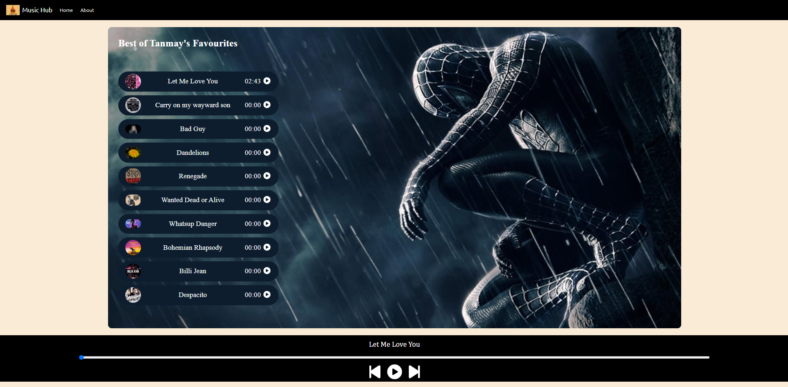

# Music App Clone

the name is kinda self-explanatory
it is a pvt. playlist saved as a website that contains 10 of my fav. songs !!

## Live Demo

NOTE : The website isn't responsive and for best visibility , view it at 50% zoom in your browser 
Try the application at :-  https://trk-rishi.github.io/Music-App-Clone/

## Screenshots

## Technologies Used

- Frontend: HTML AND CSS
- Backend: Java Script

## How to Run It Locally

Download the repository as a folder 
and use "Live server" extension in ur compiler to view it
or simply extract all items and run the file index.html locally

## Project Structure

index.html contains the structuring of the website
style.css contains the main styling and layout of the frontend and UI
script.js makes everything functional

## Author

Tanmay Rishikesh

